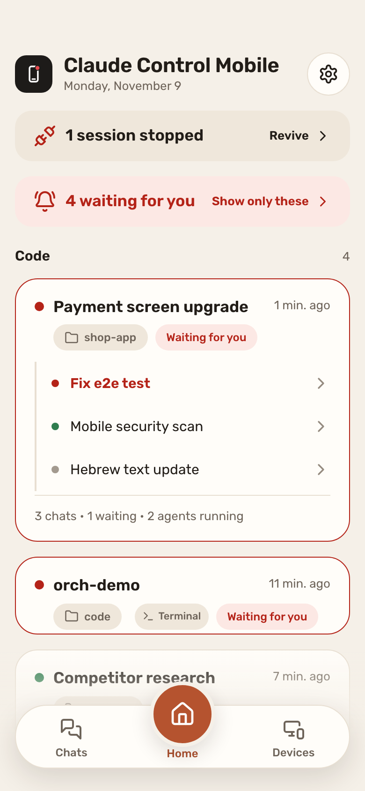
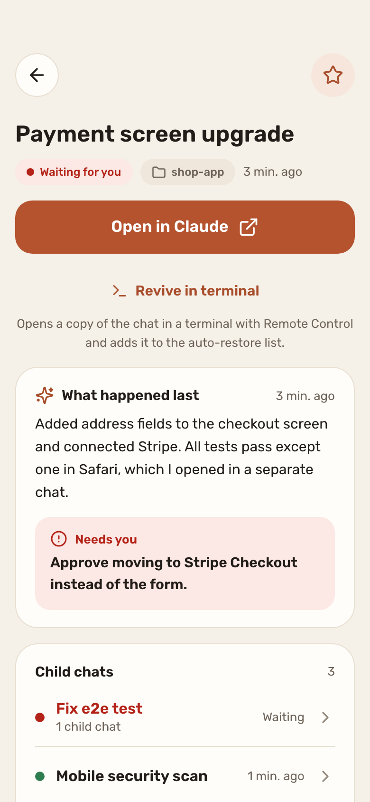
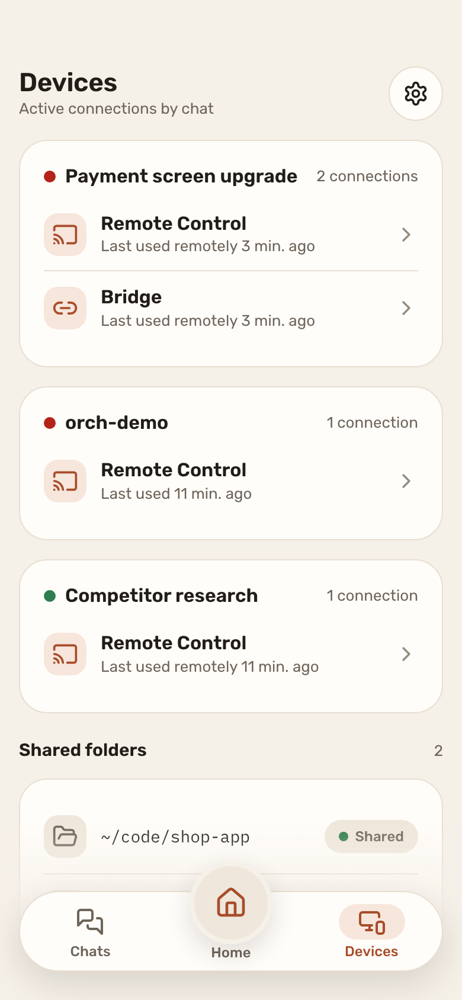

# Claude Control Mobile

See which of your Claude Code sessions are waiting for you, from your phone.

Claude Control Mobile is a small server that runs in the background on your Mac,
and a web app you add to your phone's home screen. It shows the sessions you
starred, with the same names as the Claude app. A session that waits for your
answer turns red and moves to the top. If you starred it, your phone gets a push.

It opens Claude's local session files read-only. It never changes them.

> Unofficial. Not affiliated with or endorsed by Anthropic. It reads internal,
> undocumented files of the Claude desktop app, so an app update can break it
> without notice. Claude is a trademark of Anthropic.

<p>
  
  
  
</p>

Screenshots use demo data.

## What it does

- **Home**: what is waiting for you and what you are working on. Starred sessions only.
- **Chat**: the last thing Claude did, the question it is waiting on, child chats,
  subagents, connected devices, and earlier versions of the session after a restart.
- **Push**: only when a starred session moves to "waiting for you".
- **Open in Claude**: one tap opens the session in the Claude app (Remote Control).
- **Revive**: brings a stopped terminal session back, through
  [Claude Control](https://github.com/danielmazh/claude-control) (optional).
- **Your layer**: stars, priority, labels and notes. Stored in this project, not in Claude's files.
- English and Hebrew UI.

## Sources it reads

| Source | What |
|---|---|
| `~/Library/Application Support/Claude/claude-code-sessions/` | Desktop Code sessions |
| `~/Library/Application Support/Claude/local-agent-mode-sessions/` | Cowork sessions |
| `~/.claude/projects/` | Conversation logs of terminal sessions and subagents |
| Claude Control on `127.0.0.1:7799` (optional) | Terminal session list, status, revive |

Regular claude.ai chats are out of scope. They are not stored on the computer.

## Security model

This app can open and revive sessions that run commands on your Mac. Treat it as a remote control.

- The server listens on `127.0.0.1:7810` only. Your phone reaches it through your
  Tailscale network (`tailscale serve`). No port is open to the internet.
- Every API request needs a personal token (256-bit, random, stored in `data/token`
  with owner-only permissions). The login link sets it as a cookie.
- Requests that change something must pass Host and Origin checks.
- Claude's files are opened read-only.
- Session files contain private fields (email, account name, system prompt). The
  server copies only known fields by name, so those are not sent. Titles and
  summaries are sent, and they contain whatever you typed in the session.
- The phone never talks to Claude Control. Only this server does, over localhost.

Your token, push keys and settings live in `data/`, which is in `.gitignore`.
See [SECURITY.md](SECURITY.md) to report a problem.

## Needs

- macOS, Node 22.6 or newer
- Claude desktop app and/or Claude Code CLI
- Remote Control on, for "Open in Claude"
- Tailscale on the Mac and on the phone, logged in to the same tailnet, with
  MagicDNS and HTTPS certificates on (Tailscale admin console, DNS page)
- Optional: [Claude Control](https://github.com/danielmazh/claude-control) for
  terminal sessions and revive
- Optional: `brew install qrencode` for a QR code

## Install

```sh
git clone https://github.com/danielmazh/claude-control-mobile.git
cd claude-control-mobile
scripts/tailscale-up.sh --dry-run   # see what it will do
scripts/tailscale-up.sh             # serve on https://<machine>.<tailnet>.ts.net
scripts/install.sh --dry-run        # see what it will do
scripts/install.sh                  # npm ci, build the UI, start the launchd agent
```

`install.sh` is safe to run again. Log: `~/Library/Logs/claude-control-mobile.log`.

## Connect your phone

1. Install Tailscale on the phone and log in to the same tailnet.
2. On the Mac, run `scripts/login-link.sh`. It prints a login link and a QR code.
   The link holds your token. Keep it private.
3. Open the link on the phone. It sets a login cookie.
4. Add the page to the home screen (iPhone: Share, Add to Home Screen).
5. Open it from the home screen and allow push. On iPhone, push works only from the home screen app.

## Uninstall

```sh
scripts/install.sh --uninstall      # stop the agent, remove the plist
scripts/tailscale-up.sh --down      # remove the Tailscale serve config
rm -rf data                         # optional: token, push keys, your settings
```

## Development

```sh
npm ci
npm test            # server unit tests
npm run web:dev     # UI with demo data
```

The API contract is in `docs/api.md`.

## License

MIT. Copyright (c) 2026 Daniel Mazhbits. See [LICENSE](LICENSE).
